# 🗣️ Uvoxus Voice Assistant: Control Your PC with Your Voice

---

## 📝 What is Uvoxus?

**Uvoxus Voice Assistant** is not just a voice assistant for Windows, but a **full-fledged extensible platform for automation and building your own applications**. It combines a ready-made voice control center for your computer with a flexible environment for running your own Python programs (plugins).

The main architectural feature is **deep integration with the assistant's core**. You can create your own standalone utilities, control panels, and interfaces, **directly embedding Uvoxus voice functions into them**: user command recognition and speech response generation.

Control your system, media, and routines "out of the box," or turn the assistant into a platform for realizing any of your ideas — from voice control of a smart home to interactive work dashboards.

The assistant features a modern interface and deep customization capabilities: from creating simple commands to open folders to building complex **scenarios** that automate your everyday tasks.

### 🌐 Speech Recognition Engines
Uvoxus gives you a choice between two leading technologies:
* **Google Speech Recognition (requires internet):** high accuracy for everyday speech and a rich vocabulary.
* **VOSK (works fully offline):** lightweight local Kaldi models. Full privacy, no network requests, and fast response without delays.
* **Second Opinion:** if the primary engine didn't catch the command or produced noise, the assistant instantly runs the recording through the backup engine for re-checking.
* **Smart fuzzy search (RapidFuzz & Levenshtein):** the assistant will understand the command even if you misspoke, swallowed an ending, or said the words in reverse order (*"calculator open"* instead of *"open calculator"*).
* **Push-to-Talk (PTT) mode:** the ability to activate listening only while holding a physical key (works via hardware WinAPI hooks even in fullscreen games).

### 🌏 Localization
The program has a multilingual interface and extended speech recognition support. Any user can easily create their own language translation file in the settings and submit it for inclusion in the official release.

---

## 🎯 Key Principles

* ✅ **No subscriptions:** no monthly or hidden payments.
* ✅ **All features available immediately:** no "Pro" or "Premium" versions.
* ✅ **No ads or telemetry:** nothing distracts from work and no data is transmitted.
* ✅ **Free updates:** always and for everyone.

---

## 🤔 Commands, Scenarios, and Macros: What's the Difference?

### 🚀 Single Commands
A **command** is a single point action tied to a voice trigger:
* *"Open browser"* ➔ launches the web browser.
* *"Press Enter"* ➔ emulates the Enter key.
* *"Click at coordinates 500 300"* ➔ precise mouse click at the specified screen point.
* *"Mouse to center"* ➔ centers the cursor on the monitor.

### 📜 Scenarios
A **scenario** is a chain of several sequential actions triggered by a single phrase. Scenarios are assembled in a visual node editor: blocks can be moved, connected with links, and precise **pauses** can be configured between them.

**Example of the "Work Mode" scenario:**
1. Set the power plan to "High Performance."
2. Open the VS Code program.
3. **Pause 2 seconds.**
4. Open the GitHub website.
5. Set the system volume to 50%.

### ⏺ Voice Macros
Recording a sequence of mouse clicks and keyboard presses directly via a voice command (*"remember my action"*) with saving under your own name and subsequent playback in one click or phrase.

---

## 🌟 Key Features

### 🧩 Plugin System and Developing Your Own Programs
* **More than just extensions:** a plugin inside Uvoxus is a full-fledged program that can run in the background or have its own graphical interface.
* **Voice capabilities of plugins:** use Uvoxus built-in speech recognition (STT) to create your own voice scenarios and dialogues. Plugins can receive recognized text, process triggers, and play voice responses. Third-party libraries such as `gtts` are available for generating speech from arbitrary text.
* **Instant launch:** plugins don't need to be compiled — write Python code and run it immediately inside the assistant's environment.
* **Isolation and security:** grow the ecosystem to suit your needs without having to modify the assistant's source code.

  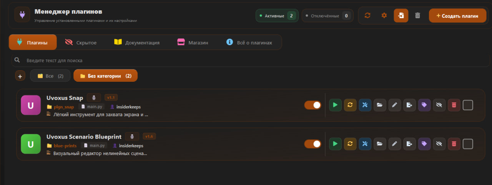
    
  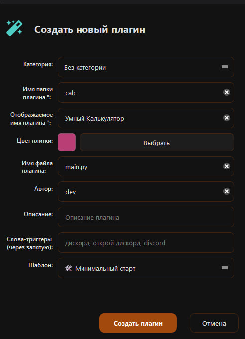

🚀 The possibilities of plugins are virtually limitless:
* **Voice mini-programs:** interactive dialogue scenarios with the assistant for specialized tasks.
* **Your own GUI interfaces:** interactive windows on PySide6 (weather, PC monitoring, crypto wallets, Docker) with their own style.
* **Integration with external software:** control Spotify, OBS Studio, smart home servers (Home Assistant), and local utilities.
* **Background daemons and services:** background data monitoring with voice notification of changes (CPU overheating, email arrival, exchange rate changes).

---

### 🛠 Development Environment — Plugin Workshop
Built-in IDE for creating and editing plugins:

* **Intelligent autocomplete:** start typing `api.` and get a list of available assistant core methods.
* **AST security validator:** scans code for forbidden libraries before saving.
* **Version history (Diff View):** built-in micro-backup system right in the editor. You can visually compare changes (diff line highlighting) and roll back to a previous version.
* **Hot Reload:** automatic silent restart of the plugin immediately after saving the file (`Ctrl + S`).
* **Watchdog control:** a watchdog timer monitors interface freezes caused by plugins and outputs a diagnostic report with the problematic line of code.
* **Template library:** ready-made skeletons (minimal script, GUI window, task scheduler, input automation, network operations).
* **Instant debugging:** Output Log shows console output and plugin errors in real time.

  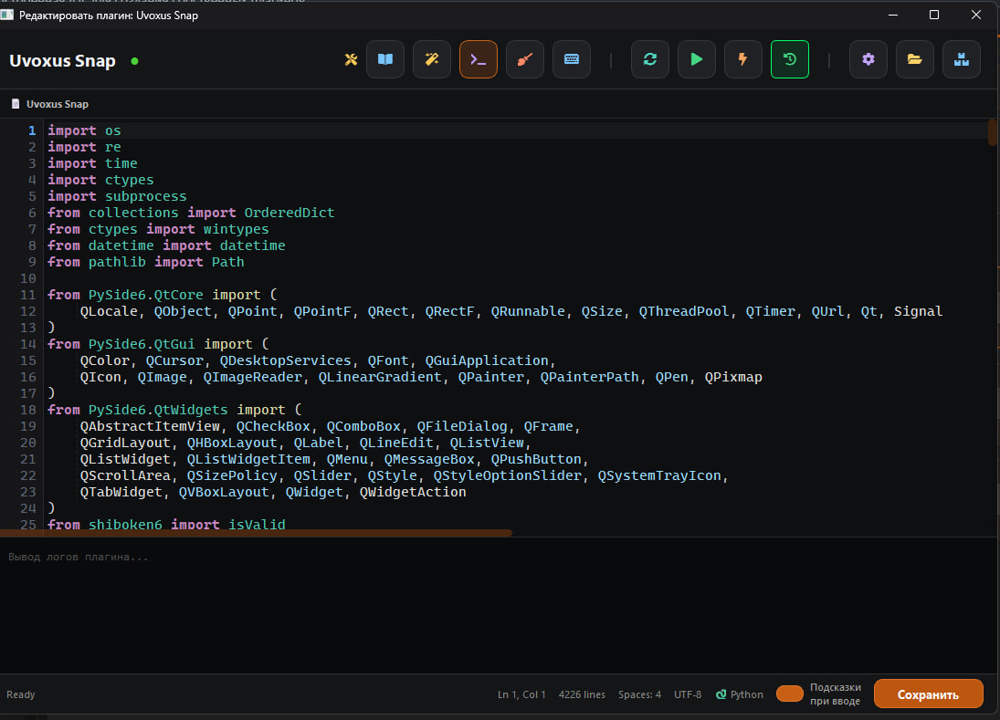

---

### 🛠 Visual Configuration Editor — Plugin Config UI
An intuitive interface for managing plugin settings without manually editing files:

* **Two editing modes:** instant switching between a visual form with sliders/fields and direct JSON code.
* **Tree structure of parameters:** support for nested objects, arrays, and profiles.
* **Smart field types:** automatic detection of text, numbers, checkboxes, and lists with syntax highlighting.
* **Centralized list:** convenient switching between configurations of all installed plugins on a single sidebar.

  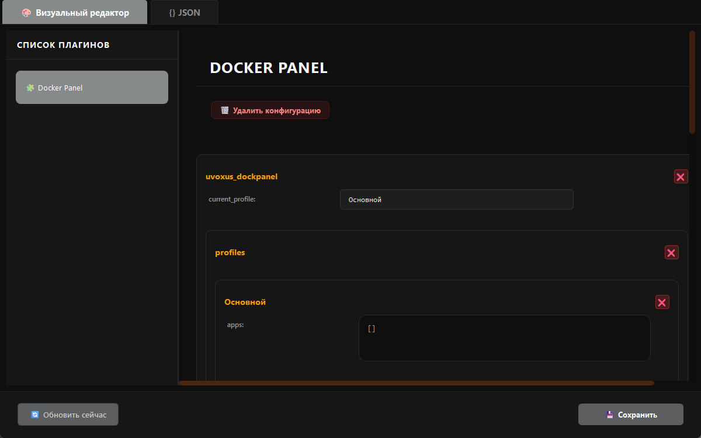

---

### 🛒 Add-on Store (Marketplace)
A catalog of ready-made verified plugins: installation, update checking, and module upgrades in one click without manual file work.

  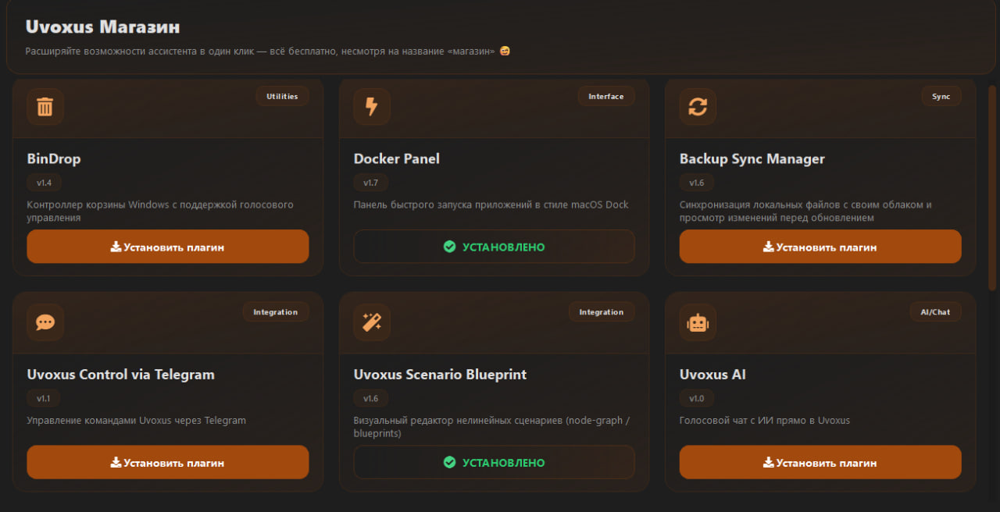

---

### 🛰 Visual Feedback and Overlays
* **Uvoxus Pulse (floating widget):** a neat overlay on the desktop with the current assistant status and recognized phrase. It has a built-in game mode — automatically minimizes or hides when fullscreen 3D games are launched.
* **Edge Flash (contour screen highlighting):** visual flashes around the screen perimeter (listening, success, error). Ideal when playing with headphones when system sounds aren't audible.
* **Subtitles on top of all windows:** displays what the assistant heard right on top of the screen in 8 visual styles (`pill`, `card`, `bar`, `wave`, `terminal`, `segment`, `orb`, `bubble`).
* **Seasonal atmosphere:** Seasonal themes on holiday dates.

---

## 📊 Interface Overview

### - Below are the key sections of the application (screenshots may differ slightly over time due to feature updates):

<table style="border-spacing: 25px; text-align: center; width: 100%;">
  <tr>
    <td valign="top" width="33%">
      <b>🖥️ Main Screen</b> 
      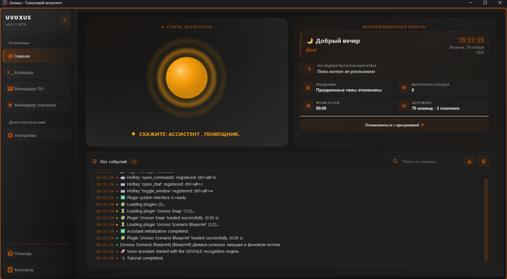 
      
Control center. Displays the assistant status, indicator widget, and real-time event log.

    </td>
    <td valign="top" width="33%">
      <b>🗂️ Command Editor</b> 
      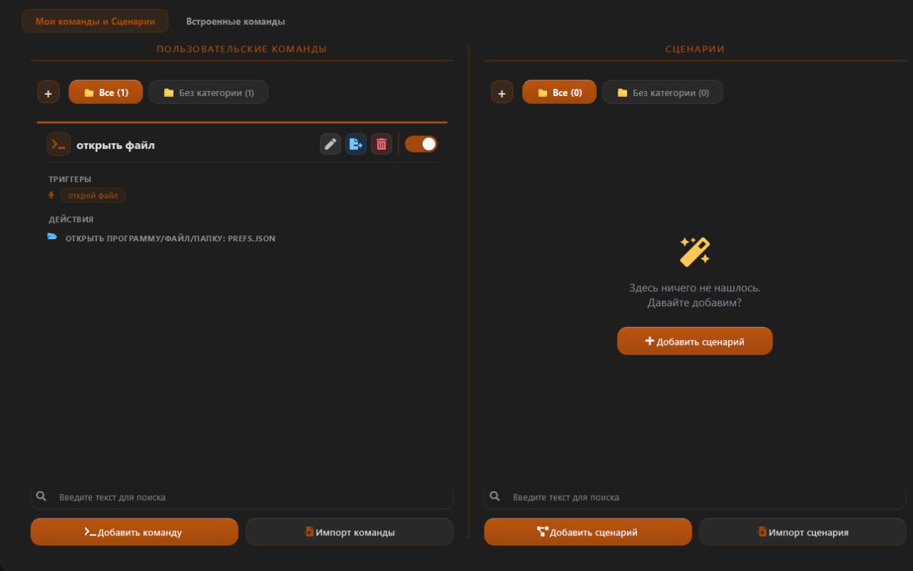 
      
Create, edit, and organize your commands and scenarios into categories in a convenient visual interface.

    </td>
    <td valign="top" width="33%">
      <b>⚙️ Flexible Settings</b> 
      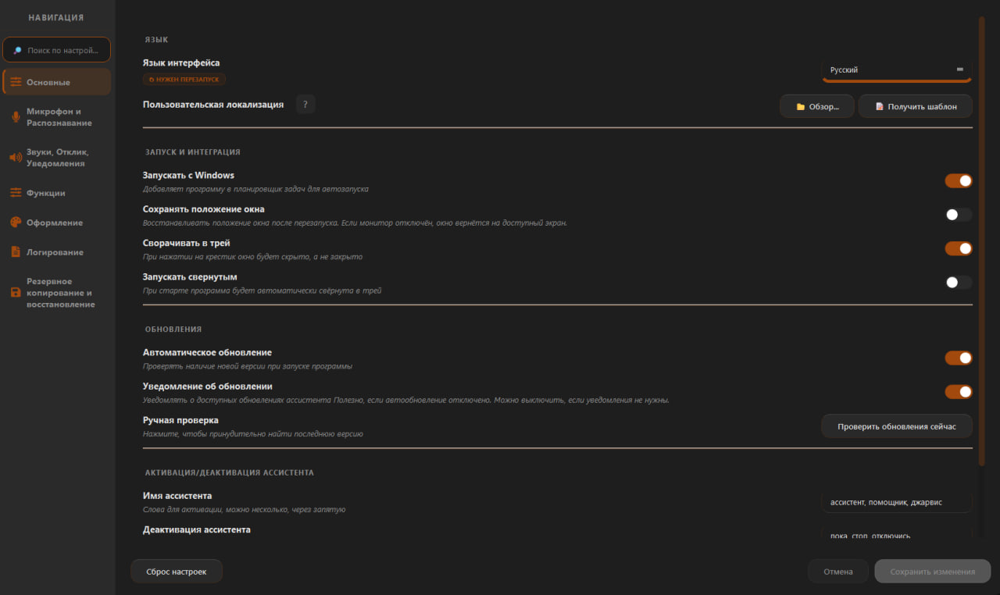 
      
Configure everything: from the assistant's name and microphone to the recognition engine and system behavior.

    </td>
  </tr>
  <tr>
    <td valign="top" width="33%">
      <b>🚀 Built-in Commands</b> 
      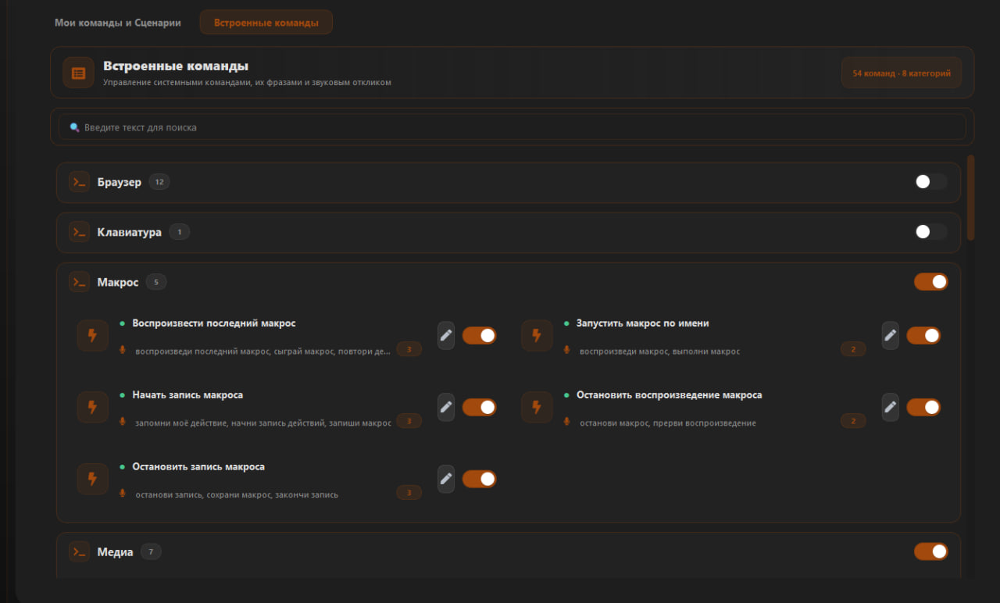 
      
Dozens of ready-made system commands. Enable, disable, or modify their trigger phrases and parameters to suit you.

    </td>
    <td valign="top" width="33%">
      <b>🚀 User Commands</b> 
      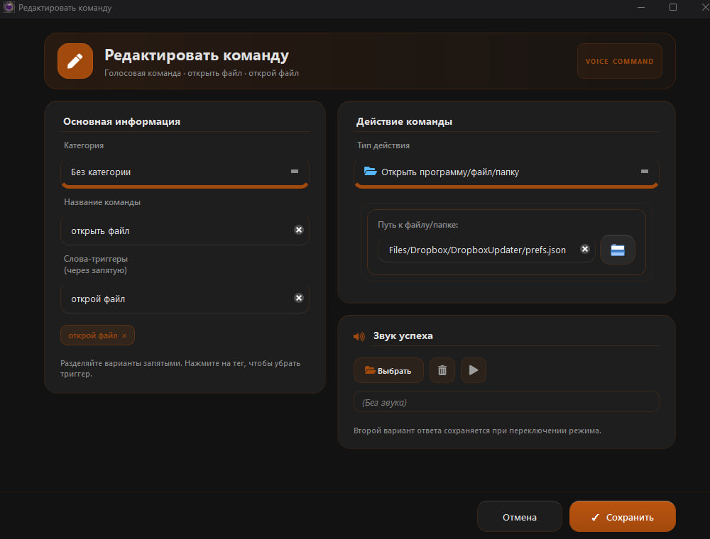 
      
Create your own simple commands to launch programs, open folders/websites, or press keys.

    </td>
    <td valign="top" width="33%">
      <b>📜 Advanced Scenarios</b> 
      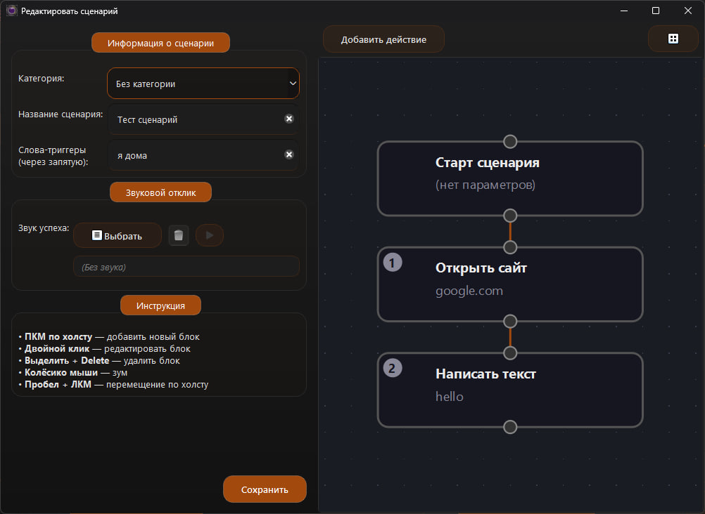 
      
Combine multiple actions into a single scenario. Change their order, add pauses, and automate routines.

    </td>
  </tr>
  <tr>
    <td valign="top" width="33%">
      <b>💡 Smart Recognition</b> 
      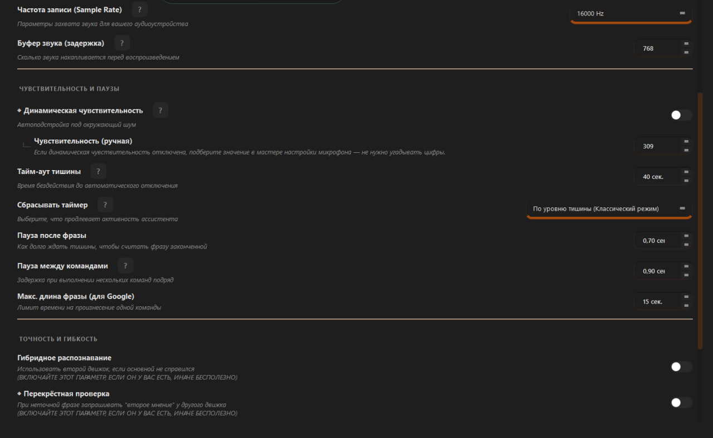 
      
Sensitivity parameters, fuzzy search, pause thresholds, and cross-checking of engines.

    </td>
    <td valign="top" width="33%">
       <b>🎨 Theme Customization</b> 
      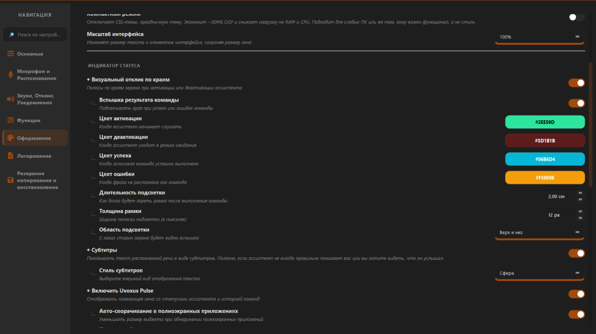      
      
Font, transparency, and compact mode settings. Choice of sphere animations, Edge Flash flashes, and subtitle styles.

    </td>
    <td valign="top" width="33%">
      <b>💭 Test Chat with the Assistant</b> 
      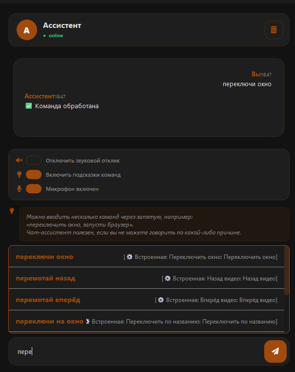 
      
If speaking aloud is inconvenient or noisy — send any commands as text through a separate pop-up window.

    </td>
  </tr>
  <tr>
    <td valign="top" width="33%">
      <b>⬇️ System Tray Menu</b> 
      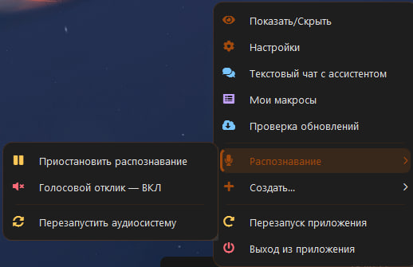 
      
Convenient menu in the system tray: quick recognition switching, voice output disabling, and audio stream restart.

    </td>
    <td valign="top" width="33%">
      <b>🎛 Event Control and Debugging</b> 
      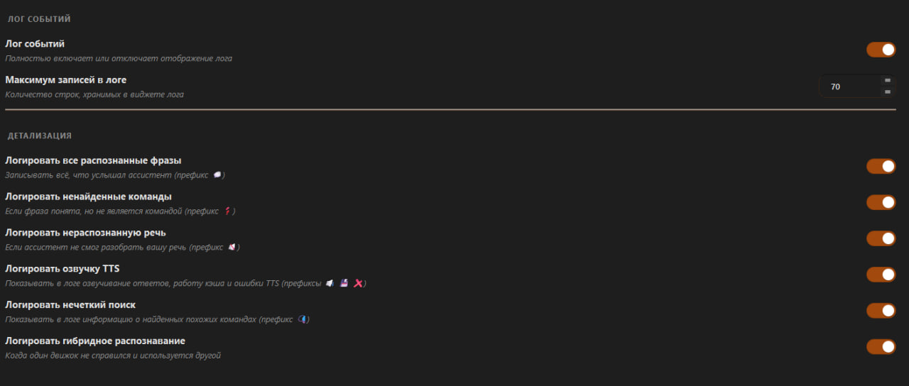 
      
Complete operation log: recording of recognized phrases, system events, and errors with the ability to repeat a command in one click.

    </td>
  </tr>
</table>

---

## 🛠 Additional Features

* 📥 **Backup:** saving all settings, scenarios, macros, plugins, and audio files into a single ZIP archive for quick transfer.
* 🎹 **Hotkeys:** binding quick key combinations to call the window, open commands, chat, or walkie-talkie mode.
* 🌐 **Browser control:** opening websites, creating and closing tabs, forward/back navigation, refresh, page scrolling by voice.
* ⌨️ **Keyboard emulation:** pressing any key combinations (`Ctrl + Shift + Esc`) and typing text under the cursor.
* 💻 **Console commands:** running any terminal commands, including in hidden mode without opening a black console window.
* 📂 **Quick access:** instant opening of system folders ("Downloads," "Documents," "Images").
* 🗑 **Recycle Bin cleanup:** freeing up disk space with one short phrase.
* 🎛 **Power management:** switching Windows power plans ("Power Saver," "Balanced," "High Performance").
* 🔆 **Brightness adjustment:** setting the monitor brightness level by voice (for supported devices).
* 🔊 **System sound:** setting precise volume in percentages (*"volume 25"*), step-by-step changes, and instant Mute.

---

## 🔊 Sound Response Personalization

You can customize the assistant's response voice to suit you — both speech synthesis and audio file playback are supported.

  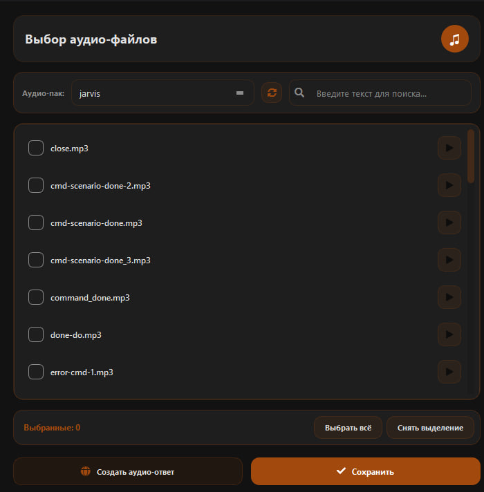

### Features
* 🗣 **Speech synthesis (Google TTS):** voicing any text responses on the fly with automatic saving to a local cache (repeated responses don't require the network).
* 🎵 **Your own audio files:** support for `.mp3`, `.wav`, `.ogg` formats for any commands and scenarios.
* 🎲 **Random replies:** attach multiple files to a command, and the assistant will choose a random sound each time it triggers.
* 📁 **Audio packs:** organize sounds into separate folders inside the `audio` directory for quick switching of design themes.
* 🔇 **Audio Ducking:** automatic lowering of music and system sounds on the PC during assistant reply playback.

### How to Add Your Own Sounds
1. Open the `audio` folder next to the program.
2. Copy sound files there (you can create subfolders).
3. In the command or scenario editor, click **"Select Sound"**.
4. Save the changes.

---

## 🖥️ Supported Systems

| System | Support | Notes |
| :--- | :---: | :--- |
| Linux | ❌ | Not supported |
| macOS | ❌ | Not planned |
| Windows 7 / 8 | ❌ | Not supported |
| **Windows 10** | ✔️ | **Fully supported** |
| **Windows 11** | ✔️ | **Recommended** |

---

## 📥 Download

| 📂 Resource | 🌐 Link |
| :--- | :--- |
| **Latest version** | [**Download from GitHub Releases**](https://github.com/Farmerok/Uvoxus-Voice-Assistant/releases/latest) |
| All releases | [Version history](https://github.com/Farmerok/Uvoxus-Voice-Assistant/releases) |

---

## ⚠️ Important Information

### Antivirus Warning
Uvoxus interacts deeply with the Windows API: it intercepts global hotkeys, emulates mouse clicks, and manages application processes. Due to the absence of an expensive commercial digital signature, heuristic antivirus scanners may produce false positives. **The project's source code is fully open and verifiable.** Add the assistant's folder to your antivirus exclusions.

### Running as Administrator is Mandatory
Administrator rights are necessary so that the assistant can:
* Correctly manage windows and programs running with elevated privileges.
* Reliably intercept system key combinations and work in Push-to-Talk mode on top of any games.
* Adjust power settings and system services without OS blocking.

---

## ⚙️ First Launch and Setup

### 🚀 Initial Setup

1. **Download and unpack:** download the latest release archive and unpack it into a permanent folder (e.g., `C:\Uvoxus\`).

2. **Launch the assistant:** run `Uvoxus.exe` as administrator.

3. **Open settings:** go to the **"Settings" → "Microphone"** tab.

4. **Configure the microphone:** click the **"Microphone Setup Wizard"** button. It will visually display the background noise level and help you select the optimal microphone sensitivity.

5. **Set the activation name:** in the general settings, specify one or more names the assistant will respond to (e.g., `Kesha`, `Assistant`, `Jarvis`).

6. **Save changes:** apply the settings to save the selected parameters.

7. **Create a command:** go to the **"Commands"** tab, create a new command, and set a trigger and the required action for it.

8. **Test it:** say the assistant's activation name into the microphone. The indicator will switch to **"LISTENING…"** mode. Then say the trigger of the created command and verify its execution.

---

## 📞 Help and Feedback

* **Telegram:** [@insiderkeeps](https://t.me/insiderkeeps)
* **Found a bug or have an idea?** [Create an Issue on GitHub](https://github.com/Farmerok/Uvoxus-Voice-Assistant/issues/new)