# 🗣️ Uvoxus Voice Assistant: Управляйте своим ПК голосом

---

## 📝 Что такое Uvoxus?

**Uvoxus Voice Assistant** — это не просто голосовой помощник для Windows, а **полноценная расширяемая платформа для автоматизации и создания собственных приложений**. Он сочетает в себе готовый центр голосового управления компьютером и гибкую среду для запуска ваших собственных Python-программ (плагинов).

Главная особенность архитектуры — **глубокая интеграция с ядром ассистента**. Вы можете создавать собственные автономные утилиты, панели управления и интерфейсы, **напрямую внедряя в них голосовые функции Uvoxus**: распознавание команд пользователя и генерацию речевых ответов.

Управляйте системой, медиа и рутиной «из коробки», либо превратите ассистента в платформу для реализации любых своих идей — от голосового управления умным домом до интерактивных рабочих дашбордов.

Ассистент обладает современным интерфейсом и глубокими возможностями кастомизации: от создания простых команд для открытия папок до построения сложных **сценариев**, автоматизирующих ваши повседневные задачи.

### 🌐 Движки распознавания речи
Uvoxus даёт вам выбор между двумя ведущими технологиями:
* **Google Speech Recognition (требует интернет):** высокая точность для повседневной речи и богатый словарный запас.
* **VOSK (работает полностью оффлайн):** легковесные локальные модели Kaldi. Полная конфиденциальность, отсутствие запросов в сеть и быстрый отклик без задержек.
* **Перекрёстная проверка (Second Opinion):** если основной движок не расслышал команду или выдал шум, ассистент мгновенно прогоняет запись через резервный движок для перепроверки.
* **Умный нечёткий поиск (RapidFuzz & Levenshtein):** ассистент поймёт команду, даже если вы оговорились, проглотили окончание или назвали слова наоборот (*«калькулятор открой»* вместо *«открой калькулятор»*).
* **Режим Push-to-Talk (PTT):** возможность активировать прослушивание только при удержании физической клавиши (работает через аппаратные WinAPI-хуки даже в полноэкранных играх).

### 🌏 Локализация
Программа имеет мультиязычный интерфейс и расширенную поддержку распознавания речи. Любой пользователь может легко создать собственный языковой файл перевода в настройках и отправить его для добавления в официальный релиз.

---

## 🎯 Ключевые принципы

* ✅ **Без подписок:** никаких ежемесячных или скрытых платежей.
* ✅ **Все функции доступны сразу:** никаких «Pro» или «Premium» версий.
* ✅ **Без рекламы и телеметрии:** ничто не отвлекает от работы и не передаёт ваши данные.
* ✅ **Бесплатные обновления:** всегда и для всех.

---

## 🤔 Команды, сценарии и макросы: в чём разница?

### 🚀 Одиночные команды
**Команда** — это одно точечное действие, привязанное к голосовому триггеру:
* *«Открой браузер»* ➔ запуск веб-браузера.
* *«Нажми Enter»* ➔ эмуляция клавиши Enter.
* *«Кликни по координатам 500 300»* ➔ точный клик мышью в указанную точку экрана.
* *«Мышь в центр»* ➔ центрирование курсора на мониторе.

### 📜 Сценарии
**Сценарий** — это цепочка из нескольких последовательных действий, запускаемая одной фразой. Сценарии собираются в визуальном нодовом редакторе: блоки можно перемещать, соединять связями и настраивать между ними точные **паузы**.

**Пример сценария «Рабочий режим»:**
1. Установить схему питания «Высокая производительность».
2. Открыть программу VS Code.
3. **Пауза 2 секунды.**
4. Открыть сайт GitHub.
5. Установить громкость системы на 50%.

### ⏺ Голосовые макросы
Запись последовательности кликов мыши и нажатий клавиатуры прямо по голосовой команде (*«запомни моё действие»*) с сохранением под собственным именем и последующим воспроизведением в один клик или фразу.

---

## 🌟 Основные возможности

### 🧩 Система плагинов и разработка своих программ
* **Больше, чем просто расширения:** плагин внутри Uvoxus — это полноценная программа, которая может работать в фоне или иметь собственный графический интерфейс.
* **Голосовые возможности плагинов:** используйте встроенное распознавание речи Uvoxus (STT) для создания собственных голосовых сценариев и диалогов. Плагины могут получать распознанный текст, обрабатывать триггеры и воспроизводить голосовые ответы. Для генерации речи из произвольного текста доступны сторонние библиотеки, например `gtts`.
* **Мгновенный запуск:** плагины не нужно компилировать — написали код на Python и сразу запустили внутри среды ассистента.
* **Изоляция и безопасность:** развивайте экосистему под свои нужды без необходимости модифицировать исходный код самого ассистента.

  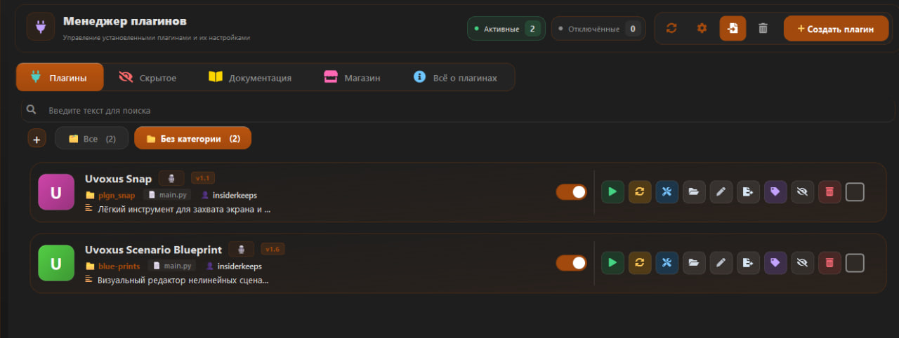
    
  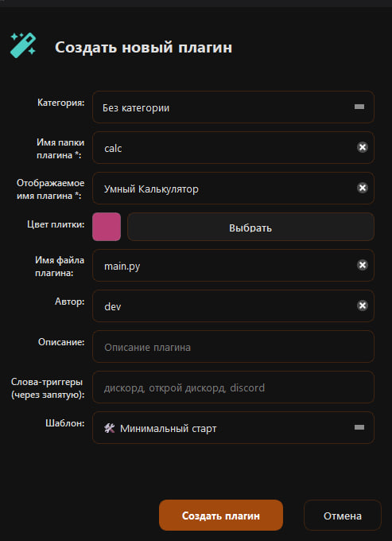

🚀 Возможности плагинов практически безграничны:
* **Голосовые мини-программы:** интерактивные сценарии диалога с ассистентом под специализированные задачи.
* **Собственные GUI-интерфейсы:** интерактивные окна на PySide6 (погода, мониторинг ПК, криптокошельки, Docker) с своим стилем.
* **Интеграция с внешним софтом:** управление Spotify, OBS Studio, серверами умного дома (Home Assistant) и локальными утилитами.
* **Фоновые демоны и сервисы:** фоновый мониторинг данных с голосовым оповещением об изменении (перегрев CPU, приход письма, изменение курса).

---

### 🛠 Среда разработки — Plugin Workshop
Встроенная IDE для создания и редактирования плагинов:

* **Интеллектуальное автодополнение:** начните писать `api.` и получите список доступных методов ядра ассистента.
* **AST-валидатор безопасности:** сканирует код на запрещённые библиотеки перед сохранением.
* **История версий (Diff View):** встроенная система микро-бэкапов прямо в редакторе. Можно визуально сравнить изменения (diff-подсветка строк) и откатиться к предыдущей версии.
* **Hot Reload:** автоматический тихий перезапуск плагина сразу после сохранения файла (`Ctrl + S`).
* **Watchdog-контроль:** сторожевой таймер отслеживает зависания интерфейса плагинами и выводит диагностический отчёт с проблемной строкой кода.
* **Библиотека шаблонов:** готовые каркасы (минимальный скрипт, GUI-окно, планировщик задач, автоматизация ввода, работа с сетью).
* **Мгновенный дебаг:** Output Log показывает вывод консоли и ошибки плагина в реальном времени.

  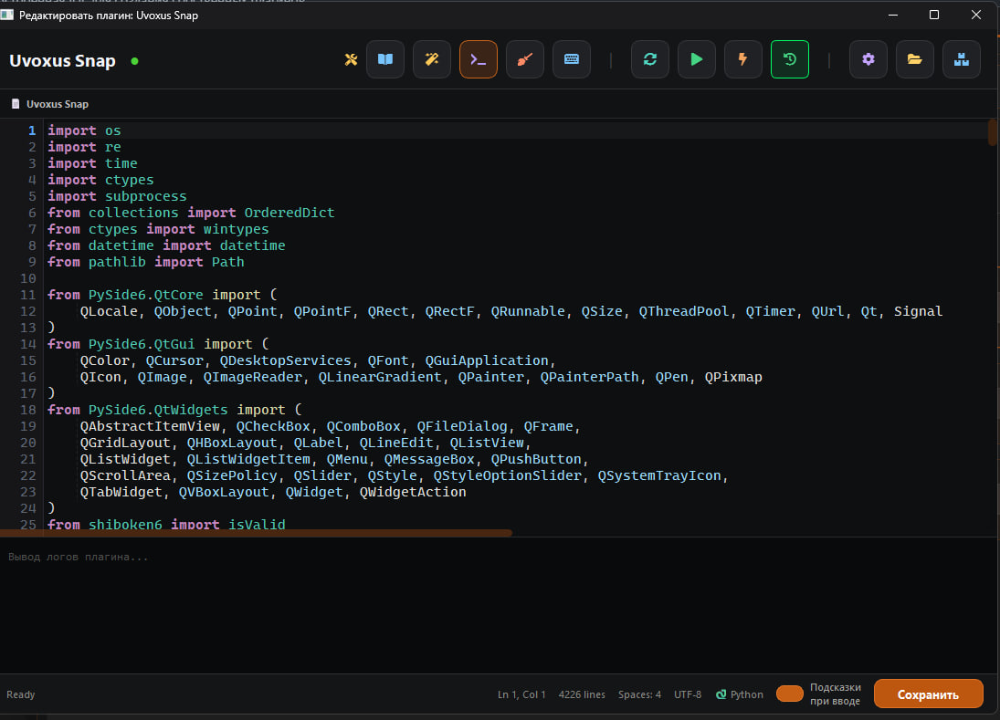

---

### 🛠 Визуальный редактор конфигураций — Plugin Config UI
Интуитивный интерфейс для управления настройками плагинов без ручного редактирования файлов:

* **Два режима редактирования:** мгновенное переключение между визуальной формой со слайдерами/полями и прямым JSON-кодом.
* **Древовидная структура параметров:** поддержка вложенных объектов, массивов и профилей.
* **Умные типы полей:** автоматическое определение текста, чисел, чекбоксов и списков с подсветкой синтаксиса.
* **Централизованный список:** удобное переключение между конфигурациями всех установленных плагинов на одной боковой панели.

  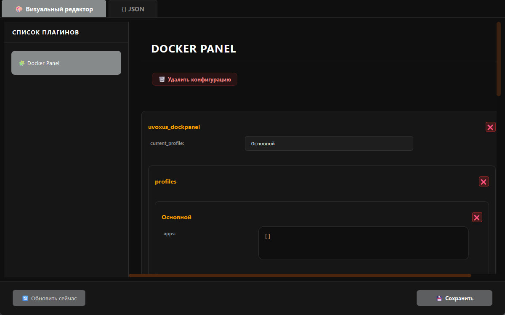

---

### 🛒 Магазин дополнений (Marketplace)
Каталог готовых проверенных плагинов: установка, проверка обновлений и апгрейд модулей в один клик без ручной работы с файлами.

  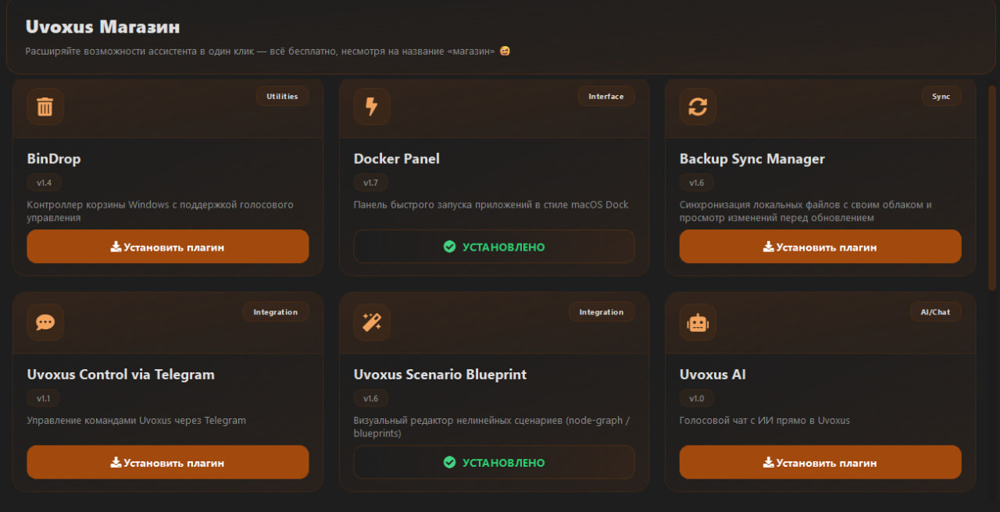

---

### 🛰 Визуальный фидбек и оверлеи
* **Uvoxus Pulse (плавающий виджет):** аккуратный оверлей на рабочем столе с текущим статусом ассистента и распознанной фразой. Имеет встроенный игровой режим — автоматически сворачивается или скрывается при запуске полноэкранных 3D-игр.
* **Edge Flash (контурная подсветка экрана):** визуальные вспышки по периметру экрана (прослушивание, успех, ошибка). Идеально при игре в наушниках, когда системные звуки не слышны.
* **Субтитры поверх всех окон:** вывод того, что ассистент услышал, прямо поверх экрана в 8 визуальных стилях (`pill`, `card`, `bar`, `wave`, `terminal`, `segment`, `orb`, `bubble`).
* **Сезонная атмосфера:** Сезонные темы в праздничные даты.

---

## 📊 Обзор интерфейса

### - Ниже представлены ключевые разделы приложения (скриншоты могут со временем незначительно отличаться из-за обновлений функционала):

<table style="border-spacing: 25px; text-align: center; width: 100%;">
  <tr>
    <td valign="top" width="33%">
      <b>🖥️ Главный экран</b> 
      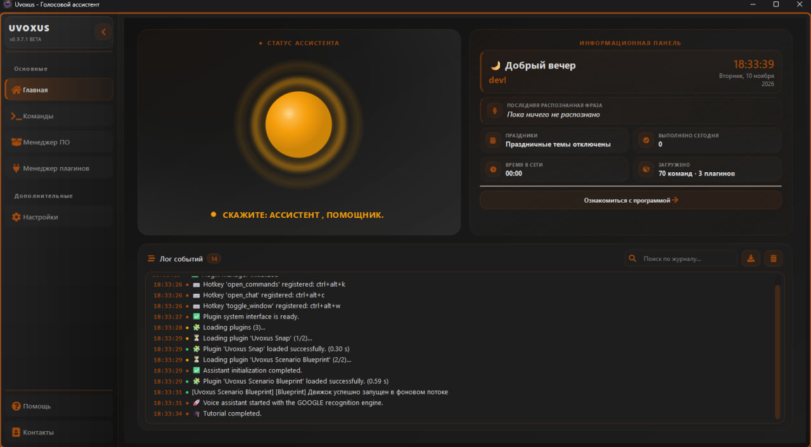 
      
Центр управления. Здесь отображается статус ассистента, виджет индикатора и журнал событий в реальном времени.

    </td>
    <td valign="top" width="33%">
      <b>🗂️ Редактор команд</b> 
      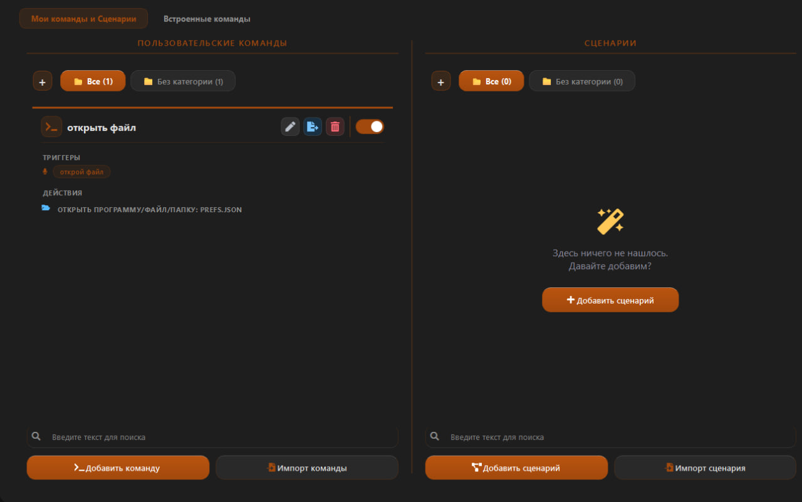 
      
Создавайте, редактируйте и раскладывайте по категориям ваши команды и сценарии в удобном визуальном интерфейсе.

    </td>
    <td valign="top" width="33%">
      <b>⚙️ Гибкие настройки</b> 
      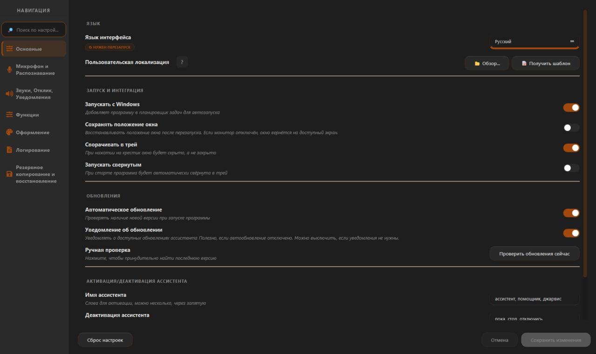 
      
Настройте всё: от имени ассистента и микрофона до движка распознавания и поведения в системе.

    </td>
  </tr>
  <tr>
    <td valign="top" width="33%">
      <b>🚀 Встроенные команды</b> 
      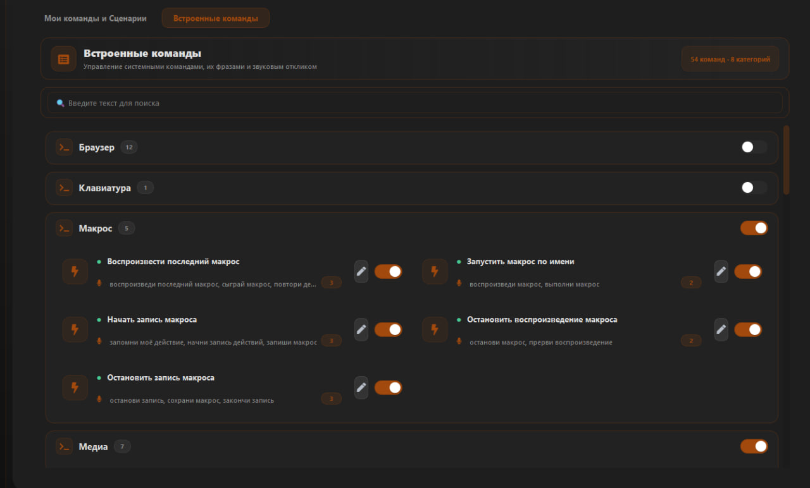 
      
Десятки готовых системных команд. Включайте, отключайте или изменяйте их фразы-триггеры и параметры под себя.

    </td>
    <td valign="top" width="33%">
      <b>🚀 Пользовательские команды</b> 
      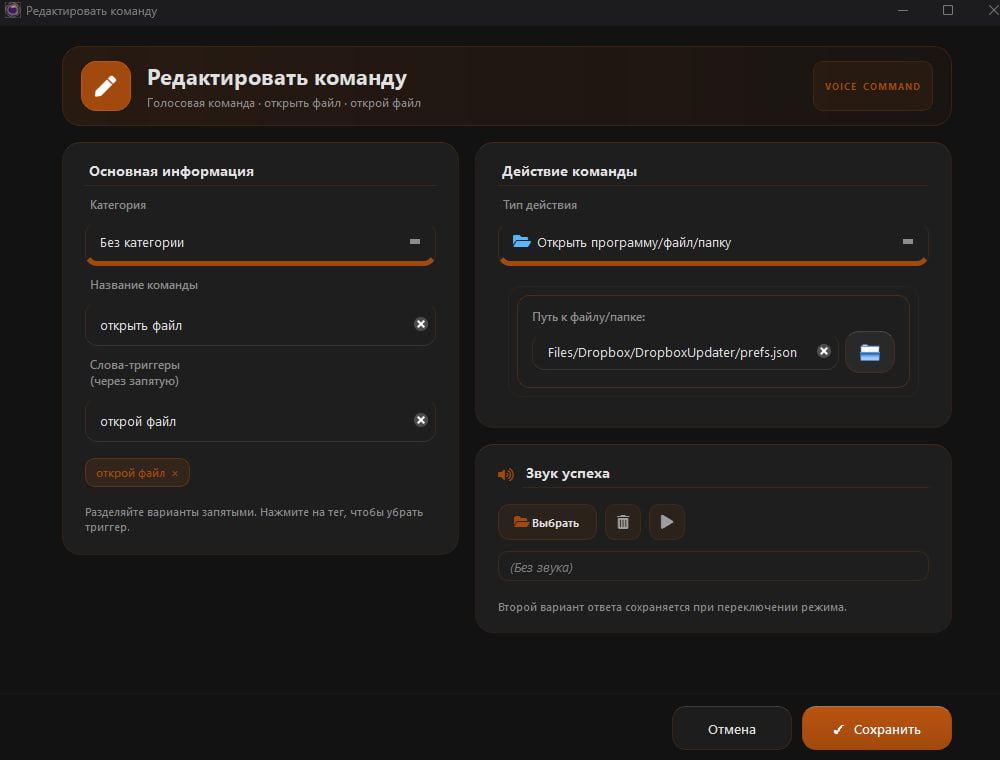 
      
Создавайте собственные простые команды для запуска программ, открытия папок/сайтов или нажатия клавиш.

    </td>
    <td valign="top" width="33%">
      <b>📜 Продвинутые сценарии</b> 
      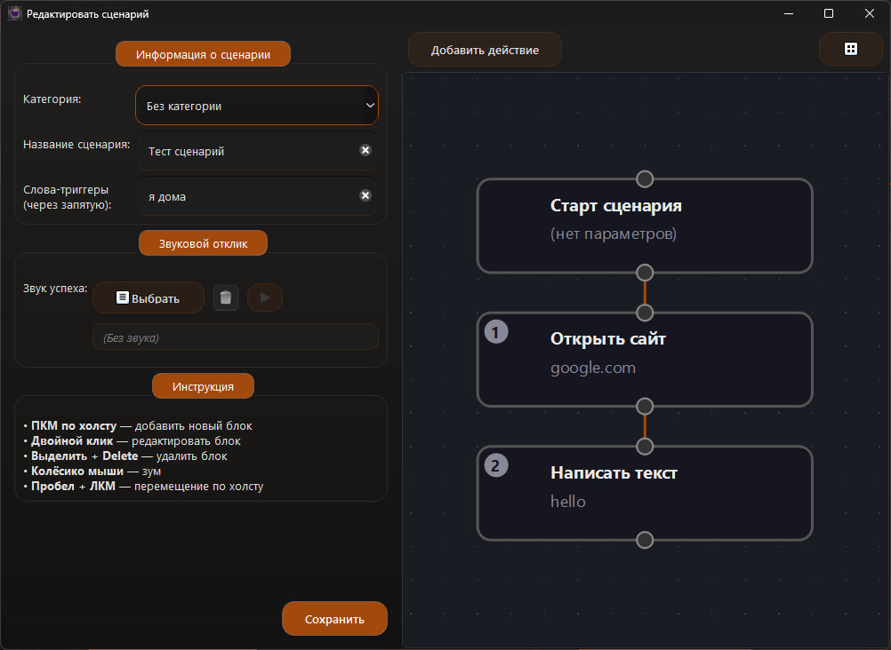 
      
Объединяйте множество действий в один сценарий. Меняйте их порядок, добавляйте паузы и автоматизируйте рутину.

    </td>
  </tr>
  <tr>
    <td valign="top" width="33%">
      <b>💡 Умное распознавание</b> 
      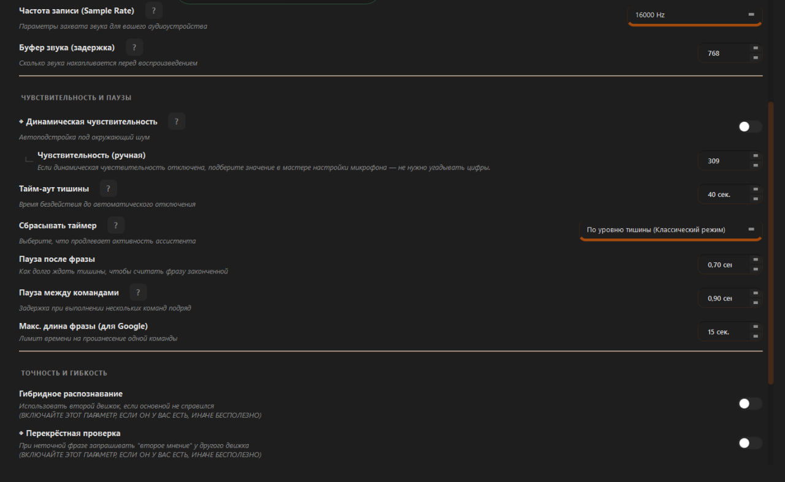 
      
Параметры чувствительности, нечёткий поиск, пороги пауз и перекрёстная проверка движков.

    </td>
    <td valign="top" width="33%">
       <b>🎨 Настройка тем</b> 
      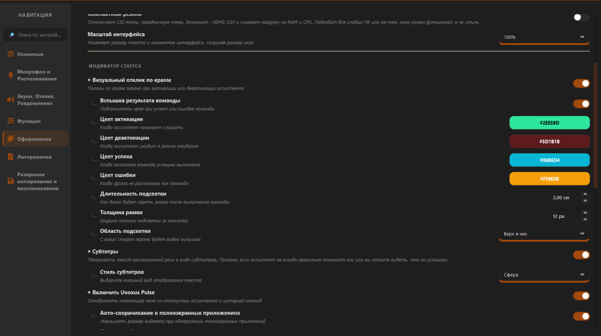      
      
Настройка шрифтов, прозрачности и компактного режима. Выбор анимаций сферы, вспышки Edge Flash и стилей субтитров.

    </td>
    <td valign="top" width="33%">
      <b>💭 Тестовый чат с ассистентом</b> 
      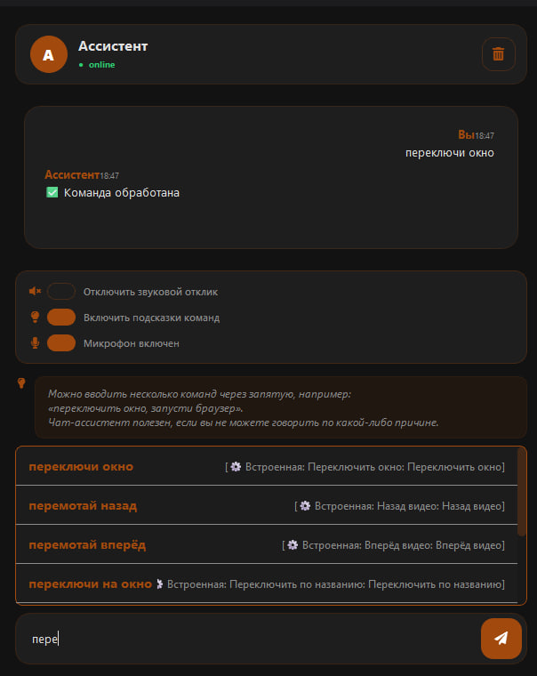 
      
Если говорить вслух неудобно или шумно — отправляйте любые команды текстом через отдельное всплывающее окно.

    </td>
  </tr>
  <tr>
    <td valign="top" width="33%">
      <b>⬇️ Меню системного трея</b> 
      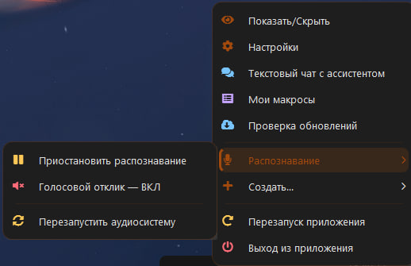 
      
Удобное меню в системном трее: быстрое переключение распознавания, отключение озвучки и перезапуск аудиопотока.

    </td>
    <td valign="top" width="33%">
      <b>🎛 Контроль событий и отладка</b> 
      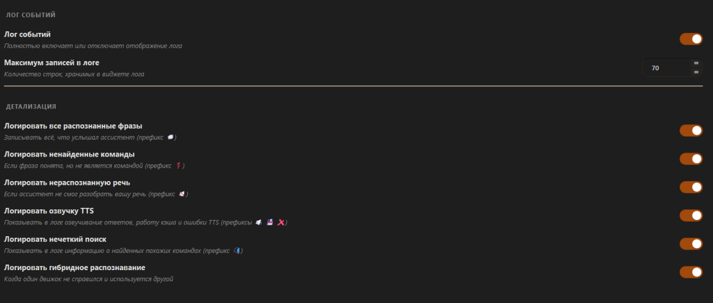 
      
Полный журнал работы: запись распознанных фраз, системных событий и ошибок с возможностью повтора команды в один клик.

    </td>
  </tr>
</table>

---

## 🛠 Дополнительные функции

* 📥 **Резервное копирование:** сохранение всех настроек, сценариев, макросов, плагинов и аудиофайлов в один ZIP-архив для быстрого переноса.
* 🎹 **Горячие клавиши:** привязка быстрых сочетаний клавиш к вызову окна, открытию команд, чату или режиму рации.
* 🌐 **Управление браузером:** открытие сайтов, создание и закрытие вкладок, переход вперёд/назад, обновление, скролл страниц голосом.
* ⌨️ **Эмуляция клавиатуры:** нажатие любых сочетаний клавиш (`Ctrl + Shift + Esc`) и набор текста под курсор.
* 💻 **Консольные команды:** запуск любых терминальных команд, в том числе в скрытом режиме без открытия черного окна консоли.
* 📂 **Быстрый доступ:** мгновенное открытие системных папок («Загрузки», «Документы», «Изображения»).
* 🗑 **Очистка корзины:** освобождение места на дисках одной короткой фразой.
* 🎛 **Управление питанием:** переключение схем электропитания Windows («Экономия», «Сбалансированная», «Высокая производительность»).
* 🔆 **Регулировка яркости:** установка уровня яркости монитора голосом (для поддерживаемых устройств).
* 🔊 **Системный звук** установка точной громкости в процентах (*«громкость 25»*), пошаговое изменение и мгновенный Mute.

---

## 🔊 Персонализация звукового отклика

Вы можете настроить озвучку ответов ассистента под себя — поддерживаются как синтез речи, так и воспроизведение аудиофайлов.

  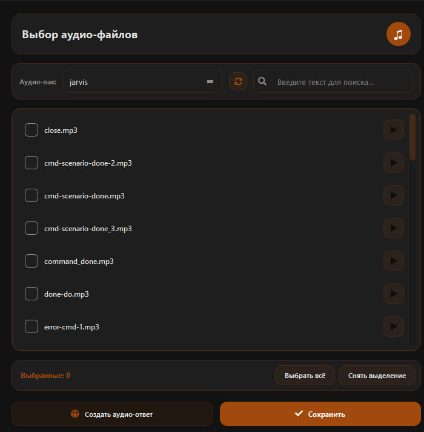

### Возможности
* 🗣 **Синтез речи (Google TTS):** озвучивание любых текстовых ответов на лету с автоматическим сохранением в локальный кэш (повторные ответы не требуют сети).
* 🎵 **Собственные аудиофайлы:** поддержка форматов `.mp3`, `.wav`, `.ogg` для любых команд и сценариев.
* 🎲 **Случайные реплики:** прикрепите к команде несколько файлов, и ассистент будет выбирать случайный звук при каждом срабатывании.
* 📁 **Аудио-паки:** организуйте звуки по отдельным папкам внутри директории `audio` для быстрого переключения тем оформления.
* 🔇 **Audio Ducking:** автоматическое приглушение музыки и системных звуков на ПК во время воспроизведения реплики ассистента.

### Как добавить свои звуки
1. Откройте папку `audio` рядом с программой.
2. Скопируйте туда звуковые файлы (можно создавать подпапки).
3. В редакторе команды или сценария нажмите **«Выбрать звук»**.
4. Сохраните изменения.

---

## 🖥️ Поддерживаемые системы

| Система | Поддержка | Примечания |
| :--- | :---: | :--- |
| Linux | ❌ | Не поддерживается |
| macOS | ❌ | Не планируется |
| Windows 7 / 8 | ❌ | Не поддерживается |
| **Windows 10** | ✔️ | **Полностью поддерживается** |
| **Windows 11** | ✔️ | **Рекомендуется** |

---

## 📥 Скачать

| 📂 Ресурс | 🌐 Ссылка |
| :--- | :--- |
| **Последняя версия** | [**Скачать с GitHub Releases**](https://github.com/Farmerok/Uvoxus-Voice-Assistant/releases/latest) |
| Все релизы | [История версий](https://github.com/Farmerok/Uvoxus-Voice-Assistant/releases) |

---

## ⚠️ Важная информация

### Предупреждение антивируса
Uvoxus глубоко взаимодействует с Windows API: перехватывает глобальные горячие клавиши, эмулирует клики мыши и управляет процессами приложений. Из-за отсутствия дорогостоящей коммерческой цифровой подписи эвристические сканеры антивирусов могут выдавать ложные срабатывания. **Исходный код проекта полностью открыт и проверяем.** Добавьте папку ассистента в исключения антивируса.

### Запуск от имени администратора обязателен
Администраторские права необходимы, чтобы ассистент мог:
* Корректно управлять окнами и программами, запущенными с повышенными привилегиями.
* Стабильно перехватывать системные сочетания клавиш и работать в режиме Push-to-Talk поверх любых игр.
* Регулировать параметры питания и системные службы без блокировок со стороны ОС.

---

## ⚙️ Первый запуск и настройка

### 🚀 Первоначальная настройка

1. **Скачайте и распакуйте:** скачайте архив последнего релиза и распакуйте его в постоянную папку (например, `C:\Uvoxus\`).

2. **Запустите ассистента:** запустите `Uvoxus.exe` от имени администратора.

3. **Откройте настройки:** перейдите во вкладку **«Настройки» → «Микрофон»**.

4. **Настройте микрофон:** нажмите кнопку **«Мастер настройки микрофона»**. Он наглядно отобразит уровень фонового шума и поможет подобрать оптимальную чувствительность микрофона.

5. **Задайте имя активации:** в общих настройках укажите одно или несколько имён, на которые будет реагировать ассистент (например, `Кеша`, `Ассистент`, `Джарвис`).

6. **Сохраните изменения:** примените настройки, чтобы сохранить выбранные параметры.

7. **Создайте команду:** перейдите во вкладку **«Команды»**, создайте новую команду и задайте для неё триггер и необходимое действие.

8. **Проверьте работу:** произнесите имя активации ассистента в микрофон. Индикатор перейдёт в режим **«СЛУШАЮ…»**. После этого произнесите триггер созданной команды и проверьте её выполнение.
---

## 📞 Помощь и обратная связь

* **Telegram:** [@insiderkeeps](https://t.me/insiderkeeps)  
* **Нашли ошибку или есть идея?** [Создайте Issue на GitHub](https://github.com/Farmerok/Uvoxus-Voice-Assistant/issues/new)